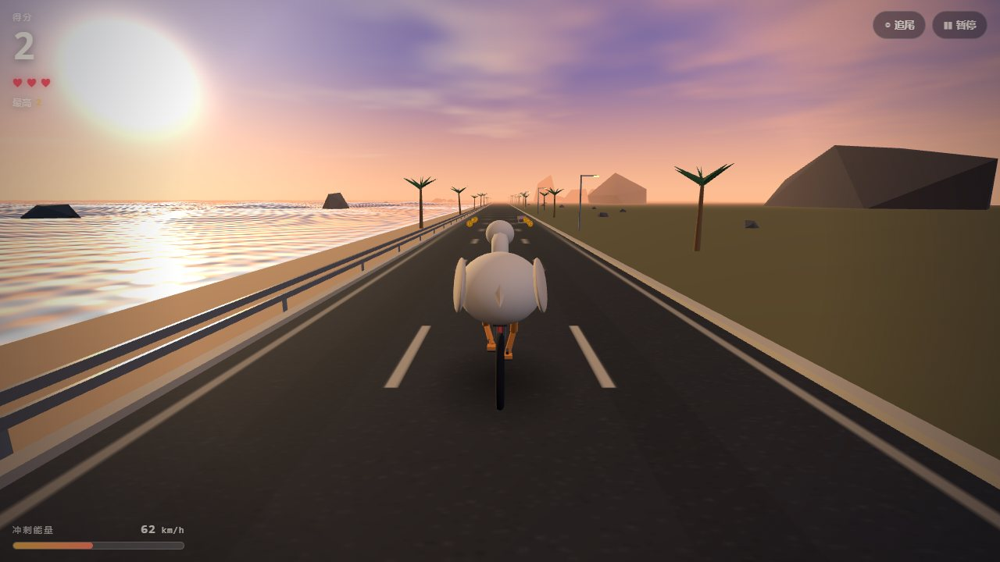
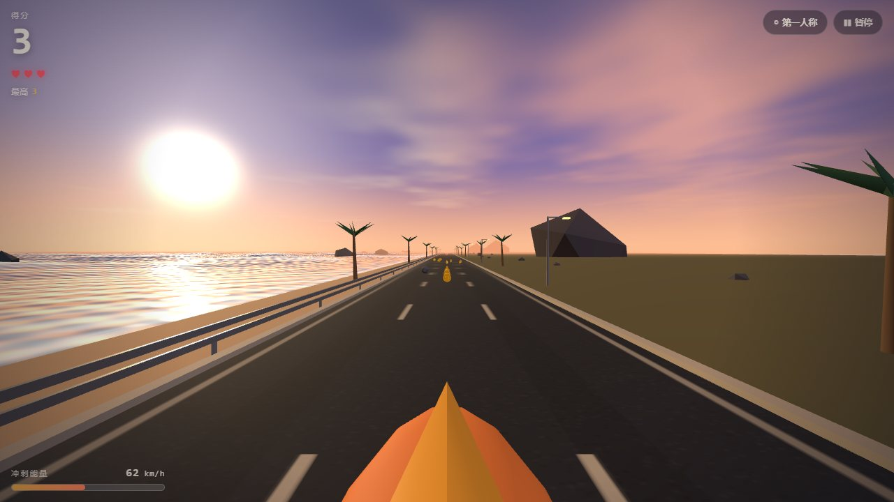
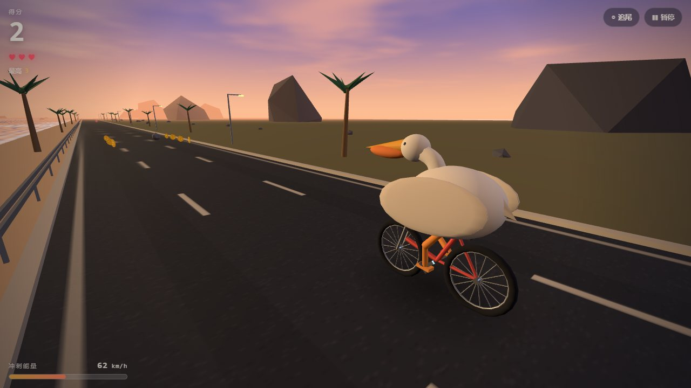

# 鹈鹕骑行 · Pelican Bike

一只鹈鹕骑着自行车，沿着夕阳下的海岸公路一路狂飙。浏览器打开就能玩，不需要下载任何东西。

**在线试玩：** https://zhanglixue9.github.io/zlxGame/



## 玩法

自动前进，你只需要躲、吃、冲、跳：

| 操作 | 键盘 | 手机 |
| --- | --- | --- |
| 左右移动 | `←` `→` / `A` `D` | 屏幕任意位置左右拖动 |
| 冲刺 | `Shift`（按住） | 右下角「冲刺」按住 |
| 跳跃 | `空格` | 右下角「跳」 |
| 转视角 | 鼠标拖拽 | 双指拖动 |
| 拉近拉远 | 滚轮 | 双指捏合 |
| 切换视角 | `C` | 右上角视角按钮 |
| 暂停 / 重开 / 静音 | `P` / `R` / `M` | 界面按钮 |

- **金币**：每个 +10 分，同时给冲刺能量充能。能量条见左下角。
- **冲刺**：消耗能量，速度 ×1.7。冲刺状态下撞到障碍物会**直接撞碎 +30 分**，不掉血；平时撞到则掉一格血并强制减速。
- **跳跃**：起跳高度约 1.14。螃蟹（0.56）能轻松跳过，路障（0.72）要掐时机，礁石（1.02）贴着顶点过。跳过去不算碰撞。
- **血瓶**：三格血上限，路上捡到红药水回一格；满血时捡到换成 +10 分。
- **结算**：血量归零出现「摔车了」，最高分存在 localStorage，关掉浏览器也在。

## 视角

三种看法，随时切换：

| 追尾（默认） | 第一人称 |
| --- | --- |
|  |  |

自由环绕可以转到侧面看海，也可以拉近看鹈鹕的脸：



停止拖拽 3.5 秒后视角会缓慢自动回正（追尾），避免骑着骑着看不见路。不想要这个行为把 `src/config.js` 里的 `camera.recenterDelay` 调大即可。

## 技术

- **Three.js + 纯程序化建模**：鹈鹕、自行车、棕榈树、礁石全部由基本几何体拼出来，没有任何模型或贴图文件。
- **海面**：自写 shader，四方向叠加涌浪 + 浪尖白沫 + 岸边碎浪 + 菲涅尔天空反射 + 太阳镜面高光与金色碎光带。
- **打包成单文件**：esbuild 把 three.js 和游戏代码一起打包成 IIFE 内联进 HTML，绕开 ES Module 在 `file://` 下的 CORS 限制。产物 550KB 左右，双击就能离线玩。

## 本地开发

```bash
npm install
npm run build     # 打包 → index.html（Pages 入口）与 dist/pelican-bike.html（本地双击版）
npm run dev       # 改 src/ 自动重新打包
```

直接用浏览器打开 `index.html` 即可，不需要起服务器。

调试参数：

- `?auto=1` 跳过菜单直接开局
- `?view=fps` 直接进第一人称
- `?near=1` 道具刷近一点，方便看模型

## 自动化测试

```bash
npm i -D playwright-core
npm test          # 13 项交互测试：跳跃、撞碎加分、掉血回血、结算、拖拽缩放、最高分
npm run shots     # 重新截 shots/*.png
```

脚本默认用系统 Edge（`channel: 'msedge'`），装的是 Chrome 的话加环境变量 `BROWSER_CHANNEL=chrome`。

## 目录

```
index.html          打包产物，GitHub Pages 入口（勿手改，由 build.mjs 生成）
src/
  main.js           主循环、状态机、碰撞与计分
  config.js         所有可调参数（速度、能量、刷怪密度、相机）
  render/           sky 天空 shader · ocean 海面 shader · road 公路 · scenery 场景道具池
  entities/         pelican 鹈鹕 · bike 自行车 · player 玩家控制 · coin · obstacle · potion
  systems/          input 键鼠触屏 · camera 环绕相机 · spawner 生成与碰撞 · audio 实时合成音效
  ui/hud.js         HUD 与界面
build.mjs           esbuild 打包脚本
test.mjs            自动化交互测试
```

想改手感基本只用动 `src/config.js`。

## License

[MIT](LICENSE)
